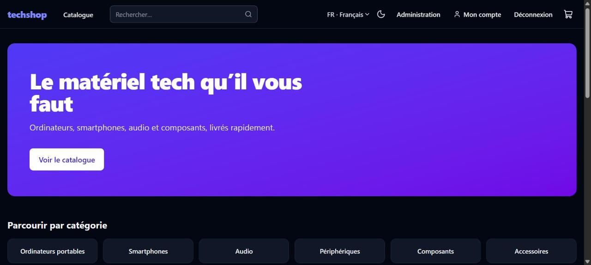
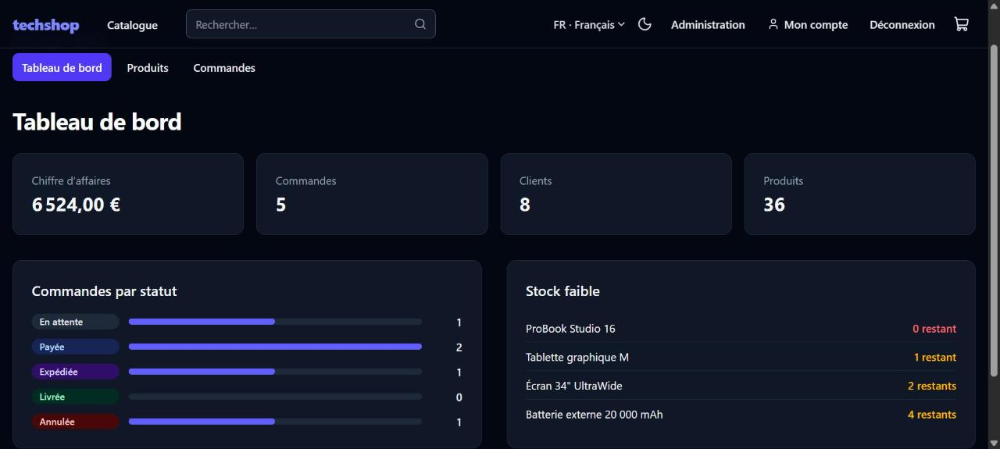

# techshop

[](https://github.com/MatheoCASSY/techshop/actions/workflows/ci.yml)

Boutique e-commerce de matériel tech, développée de zéro **uniquement avec des outils d'IA** dans le cadre d'un projet d'école, en appliquant au maximum les bonnes pratiques de développement.

> Boutique fictive : le paiement est **simulé**, aucune carte n'est débitée ni enregistrée et aucune commande n'est expédiée.



## Fonctionnalités

| Domaine           | Contenu                                                                                               |
| ----------------- | ----------------------------------------------------------------------------------------------------- |
| **Catalogue**     | Recherche, filtres (catégorie, fourchette de prix), tri (prix, nouveauté, note), pagination           |
| **Fiche produit** | Stock en temps réel, ajout au panier, avis clients avec note moyenne                                  |
| **Panier**        | Persistant (localStorage), synchronisé entre onglets et resynchronisé avec le catalogue (prix, stock) |
| **Compte**        | Inscription, connexion (session JWT en cookie httpOnly), historique et détail des commandes           |
| **Checkout**      | Adresse de livraison validée, paiement factice, page de confirmation                                  |
| **Avis**          | Note de 1 à 5 et commentaire, un seul avis par client et par produit                                  |
| **Back-office**   | Tableau de bord (CA, commandes par statut, stock faible), CRUD produits, gestion des statuts          |
| **UX**            | FR / EN, thème clair / sombre / système, responsive, accessibilité (WCAG 2.1 AA visé)                 |



## Stack

- **Front** : React 19, Vite, TypeScript strict, Tailwind CSS 4, React Router, TanStack Query, react-hook-form, i18next
- **API** : Fastify 5, Prisma 6, SQLite, Zod
- **Partagé** : `@techshop/shared`, les schémas Zod et types communs au front et à l'API (une seule source de vérité pour la validation)
- **Qualité** : Vitest, Testing Library, axe-core, ESLint, Prettier, Husky, commitlint, lint-staged
- **Livraison** : GitHub Actions, Docker (images multi-étapes, utilisateur non root), docker compose

```
techshop/
├── apps/
│   ├── api/            # API Fastify + Prisma
│   │   ├── prisma/     # schéma de la base
│   │   ├── src/routes/ # auth, catalogue, avis, commandes, admin (+ tests)
│   │   └── src/db/     # seed
│   └── web/            # SPA React
│       └── src/        # pages, composants, i18n, hooks de données
├── packages/
│   └── shared/         # schémas Zod, types, utilitaires partagés
└── .github/workflows/  # CI
```

## Démarrage rapide

### Avec Docker (le plus simple)

```bash
cp .env.example .env          # puis choisir SEED_ADMIN_PASSWORD et JWT_SECRET
docker compose up --build
```

L'application est servie sur <http://localhost:8080>. Au premier démarrage, la base est créée et peuplée automatiquement. Les données sont conservées dans un volume Docker, et un redémarrage ne les écrase pas.

### En local

Prérequis : Node.js 22 (voir `.nvmrc`).

```bash
npm install
cp apps/api/.env.example apps/api/.env   # puis renseigner JWT_SECRET (et le compte de dev)
npm run build -w @techshop/shared
npm run db:push -w @techshop/api
npm run db:seed -w @techshop/api
npm run dev                              # API sur :3000, front sur :5173
```

### Comptes créés par le seed

| Compte                  | Rôle   | Mot de passe                                                    |
| ----------------------- | ------ | --------------------------------------------------------------- |
| `admin@techshop.local`  | admin  | valeur de `SEED_ADMIN_PASSWORD`                                 |
| `client@techshop.local` | client | `demo-password` (compte de démonstration, données fictives)     |
| `DEV_USER_EMAIL`        | admin  | `DEV_USER_PASSWORD`, en local uniquement (jamais en production) |

Cartes de test pour le paiement factice : `4242 4242 4242 4242` (acceptée) et `4000 0000 0000 0002` (refusée), avec n'importe quelle date future et n'importe quel CVC.

## API

Toutes les routes sont préfixées par `/api`. Les corps et paramètres sont validés par les schémas de `@techshop/shared`.

| Méthode  | Route                      | Accès  | Rôle                                 |
| -------- | -------------------------- | ------ | ------------------------------------ |
| `GET`    | `/health`                  | public | état de l'API et de la base          |
| `POST`   | `/auth/register`           | public | inscription (ouvre la session)       |
| `POST`   | `/auth/login`              | public | connexion (limitée en débit)         |
| `POST`   | `/auth/logout`             | public | déconnexion                          |
| `GET`    | `/auth/me`                 | client | utilisateur connecté                 |
| `GET`    | `/products`                | public | recherche, filtres, tri, pagination  |
| `GET`    | `/products/:slug`          | public | fiche produit                        |
| `GET`    | `/categories`              | public | catégories et nombre de produits     |
| `GET`    | `/products/:slug/reviews`  | public | avis d'un produit                    |
| `POST`   | `/products/:slug/reviews`  | client | publier un avis                      |
| `POST`   | `/orders`                  | client | passer commande                      |
| `GET`    | `/orders`, `/orders/:id`   | client | mes commandes                        |
| `GET`    | `/admin/stats`             | admin  | indicateurs du tableau de bord       |
| `GET`    | `/admin/products`          | admin  | tous les produits                    |
| `POST`   | `/admin/products`          | admin  | créer un produit                     |
| `PUT`    | `/admin/products/:id`      | admin  | modifier un produit                  |
| `DELETE` | `/admin/products/:id`      | admin  | supprimer un produit jamais commandé |
| `GET`    | `/admin/orders`            | admin  | commandes (filtre `?status=`)        |
| `PATCH`  | `/admin/orders/:id/status` | admin  | changer le statut d'une commande     |

## Scripts

| Commande            | Rôle                                    |
| ------------------- | --------------------------------------- |
| `npm run dev`       | API et front en mode watch              |
| `npm test`          | Tests de tous les paquets               |
| `npm run lint`      | ESLint                                  |
| `npm run typecheck` | Vérification TypeScript                 |
| `npm run format`    | Formatage Prettier                      |
| `npm run build`     | Build de production de tous les paquets |

## Bonnes pratiques appliquées

**Sécurité**

- Session JWT dans un cookie `httpOnly` (inaccessible au JavaScript, donc protégé du vol par XSS) et `SameSite=Lax` (non envoyé sur les requêtes POST cross-site), `Secure` en production.
- Mots de passe hachés avec scrypt, comparaison à temps constant. La réponse est identique pour un email inconnu et pour un mauvais mot de passe, ce qui empêche l'énumération des comptes.
- Limitation de débit sur la connexion et l'inscription (force brute).
- Rôle admin relu en base à chaque requête : un admin rétrogradé perd ses droits immédiatement.
- Les prix viennent toujours de la base, jamais du client. Le stock est décrémenté de façon atomique et conditionnelle, avec annulation complète de la transaction en cas de rupture.
- Validation de toutes les entrées, en-têtes `helmet`, CORS restreint, taille des requêtes bornée, erreurs serveur jamais détaillées au client.
- La commande d'un autre client renvoie 404 et non 403, pour ne pas révéler qu'elle existe. La redirection après connexion est limitée aux chemins internes (pas de redirection ouverte).
- Aucun secret dans le dépôt : `.env.example` uniquement, `JWT_SECRET` obligatoire, et la valeur d'exemple est refusée en production. Les conteneurs ne tournent pas en root.

**Architecture et code**

- Schémas Zod partagés : le front et l'API valident avec exactement les mêmes règles.
- Prix en centimes (entiers) pour éviter les erreurs d'arrondi.
- Sérialiseurs explicites : aucun modèle de base n'est exposé tel quel.
- Note moyenne dénormalisée, recalculée dans la transaction de l'avis, pour trier par note en SQL.
- Statuts de commande gérés par une machine à états (transitions autorisées et annulation qui remet le stock).
- Filtres du catalogue dans l'URL : liens partageables et bouton « retour » qui fonctionne.
- Traductions typées : une clé manquante en anglais casse la compilation.
- Bundle découpé : le back-office est chargé à la demande et les bibliothèques sont dans des chunks mis en cache.

**Tests (112)**

- **API** : tests d'intégration sur une base SQLite jetable (`app.inject`, sans réseau), couvrant les droits d'accès, les règles métier et la sécurité.
- **Front** : Testing Library (comportement vu par l'utilisateur) et audit d'accessibilité automatisé avec axe-core sur les pages publiques.
- **Partagé** : schémas et règles métier (Luhn, expiration de carte, transitions de statut, slug).

**Accessibilité**

- Lien d'évitement, landmarks, titre de page à chaque navigation et focus replacé sur le contenu.
- Labels, aides et erreurs liés aux champs (`aria-describedby`, `aria-invalid`), annonces `aria-live`.
- Focus visible, navigation au clavier, contrastes AA en thème clair comme en sombre, `prefers-reduced-motion` respecté.

**Git et CI**

- [Conventional Commits](https://www.conventionalcommits.org/fr/) vérifiés par commitlint, lint et formatage automatiques avant chaque commit.
- Une branche et une PR par étape.
- CI : lint, formatage, types, tests et build, puis build des images Docker et test de fumée de la pile complète (`docker compose up --wait` et `/api/health` à travers nginx).

## Développé avec l'IA

Tout le code, les tests, la configuration et cette documentation ont été produits avec un assistant de code IA (Claude Code), étape par étape :

1. socle (outillage, CI, Docker) ;
2. API ;
3. front ;
4. back-office ;
5. finitions.

Les choix (projet, stack, fonctionnalités, paiement factice) ont été validés par l'humain à chaque étape. Chaque étape a été vérifiée par les tests, puis en lançant réellement l'application dans un navigateur.

## Licence

[MIT](LICENSE)
